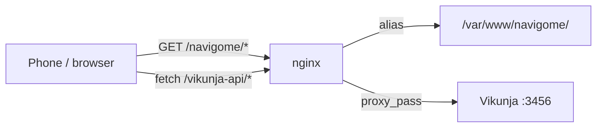

# Navigome

**State-based project management.** Your task list shouldn't be one undifferentiated wall — it should match what kind of day-part you're in.

Navigome maps the clock to a *life state* (morning · spiritual, daytime · work + errands, sunset · nature, evening · errands, night · self-care) and shows only the [Vikunja](https://vikunja.io) tasks belonging to that state. Tap a chip to take over manually; the override holds until that state's window ends, then the clock resumes.

Static HTML + vanilla JS (no build step), installable as a PWA, served behind nginx next to Vikunja.

```
┌──────────────────────────────────────────┐
│  Sunset · Nature          manual — 18:30 │
│  18:12                        next 18:30 │
│  [Morning] [Daytime] [Sunset] [Evening]  │
│  ─────────────────────────────────────── │
│  ☐  Walk by the lake                •••  │
│  ☑  Water the plants                     │
└──────────────────────────────────────────┘
```

## States

| State | Window (default) | Vikunja projects (default) |
|---|---|---|
| Morning · Spiritual | 05:00 – 09:00 | Spiritual |
| Daytime · Work + Errands | 09:00 – 17:30 | Work, Errands |
| Sunset · Nature | 17:30 – 18:30 | Nature |
| Evening · Errands | 18:30 – 21:30 | Errands, Home |
| Night · Self-care | 21:30 – 05:00 (wraps midnight) | Self-care |

Everything is edited in one file — `config.js`. Each state is `{ id, name, window: ["HH:MM","HH:MM"], projects: [vikunjaProjectIds], color }`.

## Quick start

1. Serve the folder (any static server, or nginx — see below).
2. Open the app and paste a Vikunja **API token** (Vikunja → Settings → API Tokens) into **Settings**; *Test connection* → Save.
3. Optionally point **API base** at your Vikunja instance (defaults to `/vikunja-api`, the same-origin proxy).
4. On a phone: **Add to Home Screen** — it launches standalone and works offline for the shell.

The token lives only in that browser's `localStorage`. Nothing credential-like is stored in this repo, and the same-origin proxy means the token never crosses a CORS boundary.

## Deploy (nginx + Vikunja on one box)

```nginx
location /navigome/ {
    alias /var/www/navigome/;
    try_files $uri $uri/ /navigome/index.html;
}
location /vikunja-api/ {
    proxy_pass http://127.0.0.1:3456/;          # trailing slash strips the prefix
    proxy_set_header Host $host;
    proxy_set_header X-Forwarded-For $proxy_add_x_forwarded_for;
}
# nginx has no .webmanifest in mime.types — Chrome ignores the wrong MIME
location = /navigome/manifest.webmanifest {
    alias /var/www/navigome/manifest.webmanifest;
    default_type application/manifest+json;
    add_header Cache-Control "no-cache";
}
```

Ship it:

```sh
rsync -a --exclude .git --exclude docs --exclude .superpowers --exclude TASKS.md ./ <pi>:/var/www/navigome/
```

**Always bump `CACHE` in `sw.js` when the shell changes** (e.g. `navigome-v3` → `navigome-v4`). The service worker is cache-first for app files; without a new cache name, installed clients keep the old build. `sw.js`, `index.html`, `config.js` and the manifest are served `no-cache`, so the worker itself is re-checked on every load and updates self-apply with one automatic reload after the first open.

## Architecture



| File | Role |
|---|---|
| `config.js` | state windows + Vikunja project mapping — the only file you normally edit |
| `statemachine.js` | pure time logic: window match, midnight wrap, override expiry, next transition |
| `vikunja.js` | REST client: 10 s timeouts, bearer auth, filter syntax + fallbacks, done-toggle |
| `app.js` | DOM glue: clock tick, state chips, task rows, settings, banners |
| `sw.js` | offline shell (cache-first statics, network-first API, never caches errors) |
| `tools/gen_icons.py` | stdlib-only PNG icon generator |

**Behaviour details**

- Resolution runs every 30 s; the clock and next transition tick every second.
- The list refetches only when the resolved state changes (or on reload / chip tap).
- A manual override is stored with an absolute expiry (`validUntil`), so it survives reloads and ends exactly at the state boundary.
- Checkbox toggles are optimistic: the row flips instantly, and reverts with a banner if Vikunja rejects the write.
- Failure modes are explicit: missing token → Settings opens with a banner; unreachable API → banner and the last good list stays on screen; unmapped state → banner, empty list.

## Develop

```sh
python3 -m http.server 8901     # http://127.0.0.1:8901/
node --test statemachine.test.js
python3 tools/gen_icons.py
```

No dependencies, no bundler, no framework. ES modules straight in the browser.
