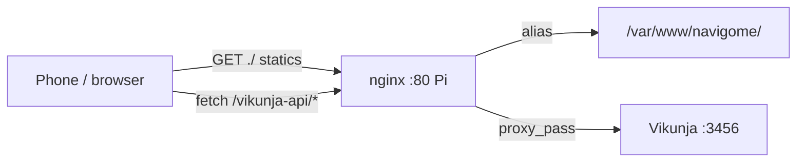

# Navigome

Time-of-day **life-state** launcher over [Vikunja](https://vikunja.io). The clock picks your current state (morning · spiritual → daytime · work+errands → sunset · nature → evening · errands → night · self-care); the app lists the Vikunja tasks mapped to it. Tap a state chip to take over manually — the override holds until that state's window ends, then the clock resumes.

Static HTML + vanilla JS (no build step), PWA-installable, served behind nginx next to Vikunja on the Pi.

## Run (dev)

```sh
python3 -m http.server 8901        # from this directory
# open http://127.0.0.1:8901/
```

First load: paste your Vikunja API token (Vikunja → Settings → API token) in Settings, set **API base** to `http://192.168.1.38:3456` for direct LAN, *Test connection* → Save. (Direct LAN needs the browser to reach the Pi; on a Mac with Sophos web protection, browser→private-IP traffic may be intercepted — use the nginx path below or whitelist the Pi.)

## Run (prod, on the Pi)

App at `http://192.168.1.38/navigome/`, API proxied same-origin at `/vikunja-api/` (default base — no CORS, no token origin issues):

```nginx
location /navigome/ {
    alias /var/www/navigome/;
    try_files $uri $uri/ /navigome/index.html;
}
location /vikunja-api/ {
    proxy_pass http://127.0.0.1:3456/;   # trailing slash strips the prefix
    proxy_set_header Host $host;
}
```

Deploy: `rsync -a --exclude .git --exclude .superpowers --exclude docs/ --exclude TASKS.md ./ pi:/var/www/navigome/`

## Architecture



- `config.js` — the only edit point: state windows (`"HH:MM"`, night wraps midnight) and `projects: [ids]` mapping (morning `[14,12]`, daytime `[6,7,10]`, sunset `[15]`, evening `[10,11]`, night `[13]`).
- `statemachine.js` — pure time logic (unit-tested); `vikunja.js` — REST client (10s timeouts, strategy ladder for task filters); `app.js` — DOM glue; `sw.js` — offline shell (never caches API results on error).
- State switching: auto by clock; chip tap = override until that window's boundary (`localStorage navigome.override`).

## Config

| localStorage key | purpose |
|---|---|
| `navigome.token` | Vikunja API token (Settings) |
| `navigome.apiBase` | `/vikunja-api` (default) or `http://192.168.1.38:3456` |
| `navigome.override` | manual state override + expiry |
| `navigome.guideSeen` | first-run guide shown |

## Tests

```sh
node --test statemachine.test.js   # 12 tests: windows, midnight wrap, override expiry, transitions
```

Icons: `python3 tools/gen_icons.py` (stdlib-only PNG generator).
